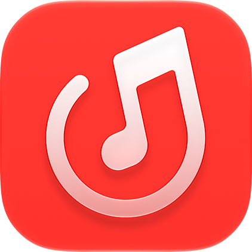

<div align="center">

# MeiloX - Salt 3D 增强版



### 带来媲美「椒盐音乐 (Salt Player)」的沉浸式 3D 空间立体歌词 · 全局 120Hz 丝滑优化

[](https://github.com/jiabaowu054-lgtm/MeiloX-Salt3D/releases)


<br/>

**[ 📥 立即下载最新 Release 安装包 (.apk) ](https://github.com/jiabaowu054-lgtm/MeiloX-Salt3D/releases)**

</div>

---

> [!IMPORTANT]
> ### 📌 项目源码来源与开源版权声明
> - **上游源项目代码仓库**：👉 **[https://github.com/NEORUAA/MeiloX](https://github.com/NEORUAA/MeiloX)**（原作者：**[NEORUAA](https://github.com/NEORUAA)**）
> - **技术基石项目**：👉 **[https://github.com/ljyh223/Mei](https://github.com/ljyh223/Mei)**
> - **二次开发说明**：本项目系基于 **`NEORUAA/MeiloX`** 的开源代码进行深度定制与增强的派生版本。所有核心网易云业务架构、登录逻辑与 Apple Music 风格液态玻璃设计均源自原作者与开源社区贡献。本项目在此基石之上，重点二次开发实现了 **椒盐音乐 (Salt Player) 风格的 3D 空间立体歌词、行间距自定义以及 Android 原生 120Hz 高刷重构**。

---

## 📖 项目简介

本项目旨在为广大音乐爱好者提供一个开箱即用的、拥有极致歌词视觉体验的网易云音乐第三方客户端。

在完整保留 MeiloX 优秀的 Apple Music 风格液态玻璃设计、网易云音乐全功能生态的前提下，本版本重点实现了**类似椒盐音乐 (Salt Player) 风格的沉浸式 3D 立体空间歌词**，并对 Android 手机高刷屏进行了针对性的**全局 120Hz/144Hz 性能重构**。

> ⚠️ **免责声明**：本项目为非官方个人开源二次开发，不隶属于网易云音乐或 Apple；音乐版权归网易云音乐及相关权利人所有。

---

## ✨ 3D 增强版核心特性

### 1. 🎵 沉浸式 3D 立体空间歌词（Salt Player 风格）
- **书页向内翻折透视**：精心调校的三维透视矩阵与景深变换，打造如书页在空间中自然微倾的立体向内延伸感。
- **动态景深模糊与字重梯度**：当前行清晰居中加粗，远离焦点的歌词呈现平滑自然的虚化景深与纤细透视，层次分明。
- **长歌词自然适应**：针对中文/外文长单句进行专项折行与透视保持，多行依然保持舒适平行的三维视觉。

### 2. 🎛️ 歌词行间距自由调节
- 在设置中提供专属的**歌词行间距调节滑块（16dp ~ 56dp 无级微调）**，轻松适配各种屏幕尺寸、字号大小及个人审美偏好。

### 3. 🫧 极简纯粹的沉浸式交互
- **智能同步收起**：歌词界面的顶部歌曲信息与底部控制条深度同步——静止闲置时自动淡出收起，让屏幕彻底留给歌词与流体背景；轻触屏幕任意区域即可随时唤回控制条。
- **自定义选项**：同时支持在设置中选择是否常驻显示顶部歌曲信息。

### 4. ⚡ 全局 120Hz / 144Hz 丝滑高刷优化
针对部分机型在 Jetpack Compose 下偶尔掉帧或被系统锁 60 帧的问题，进行了深度的性能调优：
- **原生高刷窗口解锁**：主动请求系统最优 `Display.Mode`，在 Android 14+ 上启用高优先级帧率调度，告别 OEM 系统的 60Hz 限制。
- **消除列表卡顿**：重构歌曲列表的弹窗定位逻辑，消除原本滑动时每帧数十次的视图树遍历与 Compose 状态污染。
- **零重组首帧快照**：配置项改用内存快照直读，杜绝页面启动与滑动时的级联二次重组。
- **GPU 级 RenderEffect 模糊**：3D 歌词虚化直达 GPU 渲染节点，彻底释放主线程 CPU 算力。

---

## 📲 下载与安装

请前往本项目的 **[GitHub Releases 页面](https://github.com/jiabaowu054-lgtm/MeiloX-Salt3D/releases)** 下载最新构建好的 `.apk` 安装包，安装即可直接使用，无需任何繁琐配置。

---

## 🛠️ 源码构建说明 (Build from Source)

环境要求：**JDK 21**、**Android SDK 37.0**。

```sh
# 1. 克隆本项目
git clone https://github.com/jiabaowu054-lgtm/MeiloX-Salt3D.git
cd MeiloX-Salt3D

# 2. 克隆同级 Glasmio 依赖库
git clone https://github.com/NEORUAA/Glasmio.git ../Glasmio
git -C ../Glasmio checkout 700a611f9024c8f3bd9f0b8dd26d939a0dcbeb72

# 3. 编译 Release 正式版 APK
./gradlew -Pglasmio.source=true :app:assembleRelease
```

---

## 💖 致谢 (Credits)

衷心感谢以下优秀的开源项目与作者：

- **[NEORUAA/MeiloX](https://github.com/NEORUAA/MeiloX)**：本项目代码的来源基石，提供了优秀的 Apple Music 风格界面与完备的网易云功能。
- **[ljyh223/Mei](https://github.com/ljyh223/Mei)**：MeiloX 灵感与技术架构的最初基石。
- **[椒盐音乐 (Salt Player)](https://saltplayer.app/)**：在移动端播放器歌词视觉美学上的标杆，为本项目的 3D 空间立体歌词提供了关键的审美启发。

---

## 📄 开源许可证

本项目严格遵循 **[GPL-3.0 License](./LICENSE)** 开源协议。
